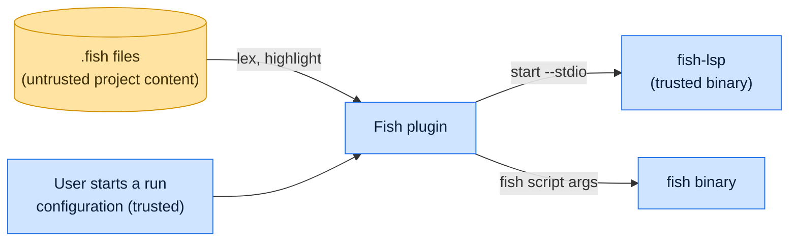

# Threat model

This model says what jetbrains-fish trusts, where untrusted input enters, and which guarantees hold at each boundary, so
a report can be classified as a vulnerability or a bug. [SECURITY.md](SECURITY.md) covers reporting; if the two
disagree, SECURITY.md wins and we fix this file.

## How jetbrains-fish works

The plugin lexes and highlights `.fish` files inside the IDE. When fish-lsp is configured or found on `PATH`, it starts
`fish-lsp start --stdio` and forwards editor requests to it for completion, diagnostics and navigation. A fish run
configuration starts the `fish` binary with the script path and arguments as separate process arguments, in the script's
directory unless the configuration names another.

## Compared with similar tools

We drew the boundary where comparable projects in other ecosystems draw theirs. The shared rule, stated by the
[Node.js threat model](https://github.com/nodejs/node/blob/main/SECURITY.md#the-nodejs-threat-model), is that a report
which first needs a trusted element compromised is out of scope; the first triage question, as
[DOMPurify](https://github.com/cure53/DOMPurify/blob/main/SECURITY.md#what-we-consider-a-vulnerability) puts it, is what
the attacker controls.

| Project                                                                                          | Language        | Where it draws the line                                                                             |
| ------------------------------------------------------------------------------------------------ | --------------- | --------------------------------------------------------------------------------------------------- |
| [JetBrains project trust](https://www.jetbrains.com/help/idea/project-security.html)             | Kotlin and Java | A project opened in safe mode runs no build scripts or run configurations until the user trusts it. |
| [VS Code Workspace Trust](https://code.visualstudio.com/docs/editing/workspaces/workspace-trust) | TypeScript      | Extensions disable features that run workspace code until the user trusts the folder.               |
| [fish shell](https://github.com/fish-shell/fish-shell/security/policy)                           | Rust            | The shell the plugin launches; private reports by email, best effort.                               |
| [IntelliJ Platform](https://github.com/JetBrains/intellij-community/security/policy)             | Kotlin and Java | Vulnerabilities in the IDE platform itself go to JetBrains, not to plugin authors.                  |

## Trusted

An attacker who controls any of these already has what jetbrains-fish could give them:

- The user, the IDE and the run configurations the user starts.
- The `fish` and `fish-lsp` binaries from the configured path or `PATH`.

## Untrusted inputs

| Input                       | Comes from                        | What jetbrains-fish guarantees                                             |
| --------------------------- | --------------------------------- | -------------------------------------------------------------------------- |
| `.fish` file contents       | A cloned project                  | Lexed by the plugin as data; passed to fish-lsp as document text.          |
| Run configuration arguments | Project-stored run configurations | Split on whitespace into separate process arguments; no shell is involved. |

## Threats and controls

| STRIDE                 | Threat                                           | Control                                    |
| ---------------------- | ------------------------------------------------ | ------------------------------------------ |
| Elevation of privilege | Opening a file runs it.                          | Scripts run only from a run configuration. |
| Tampering              | An argument like `; rm -rf ~` runs as a command. | Arguments are separate process arguments.  |

## Release chain

Releases run on the shared [tox-dev/github-workflows](https://github.com/tox-dev/github-workflows) pipeline. A release
App pushes the release commit and tag, the plugin ZIP is signed before it reaches the
[JetBrains Marketplace](https://plugins.jetbrains.com/docs/marketplace/plugin-signing.html), and the immutable GitHub
Release carries the same ZIP with GitHub's release attestation. Every workflow pins third-party actions to a commit SHA.

## Vulnerability or bug

| Report                                                              | Verdict             | Why                                                                         |
| ------------------------------------------------------------------- | ------------------- | --------------------------------------------------------------------------- |
| Opening `evil.fish` executes it                                     | Vulnerability       | Execution needs a run configuration.                                        |
| A shared run configuration runs `evil.fish` when the user starts it | Not a vulnerability | The user started it; the IDE's project trust governs shared configurations. |
| fish-lsp misbehaves on a crafted file                               | Not ours            | Report it to fish-lsp.                                                      |
| Highlighting breaks on nested command substitution                  | Bug                 | Lexer correctness.                                                          |

## Accepted risks

- fish-lsp starts when a `.fish` file opens, without consulting the IDE's trusted-project state.

## Keeping this current

Revisit this model when jetbrains-fish gains a new input source, network access, a new way to run code, or a new place
it writes to, and whenever an advisory is published.
